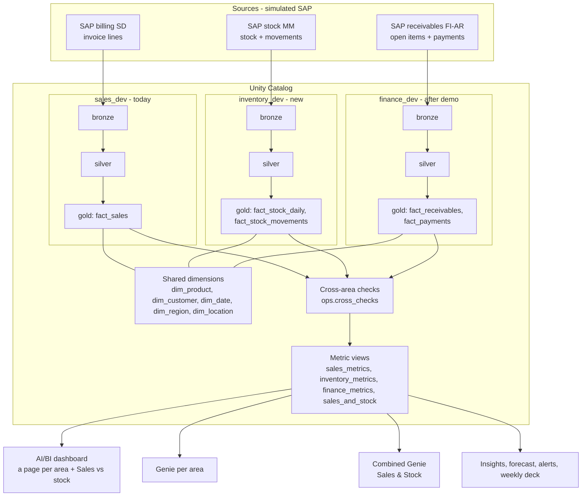
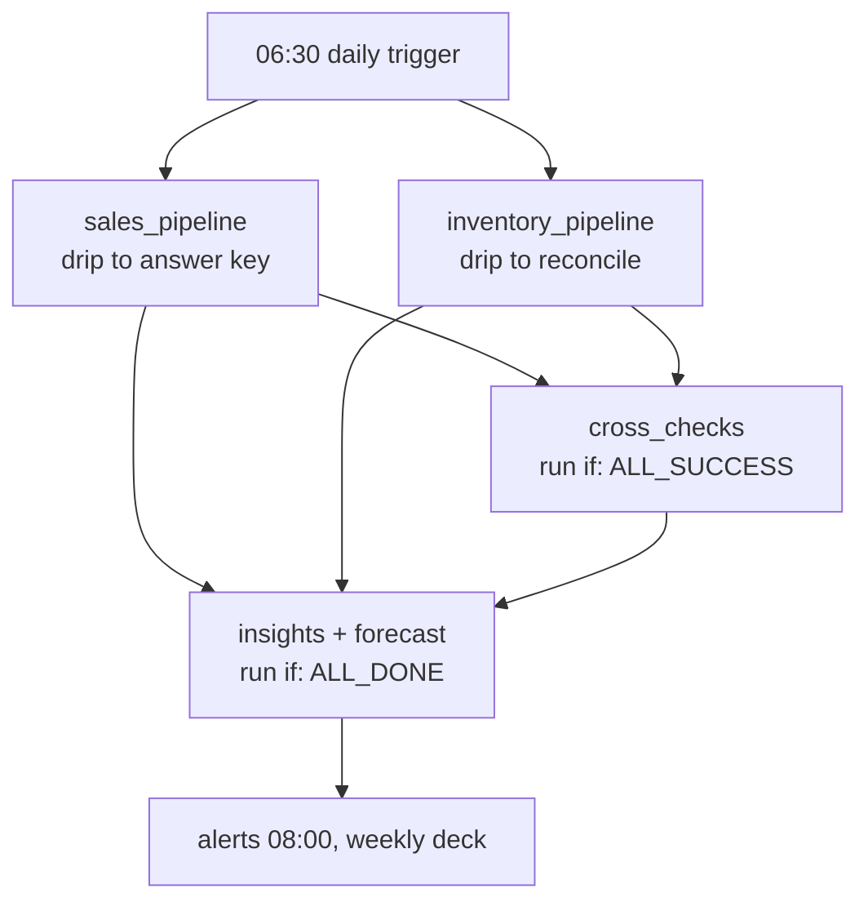

# Multiple Gold Layers: Plan

**Project:** Sales Insights MVP on Azure Databricks · **Owner:** Navtej · **Built for:** Anil
**Written:** Tue 13 Oct 2026 · **Status:** APPROVED 13 Oct (defaults). Built: PR A area support (#24), PR B inventory generator (#25), PR C inventory pipeline (local)
**Demo:** 29–30 Oct 2026 · **Azure credit ends:** 5 Nov 2026

> **What this plan does:** it adds more business areas (inventory now, finance later) next to the sales pipeline we already run. Each area gets its own bronze → silver → gold, all areas share one set of dimensions, and Genie and the dashboard can answer questions across areas.
>
> **Scope change:** the execution plan (30 Sep) covers sales only. This document proposes a change to that scope. Nothing here is built until Navtej approves it.

---

## Update, 13 Oct evening: how we build it

- **Same Azure account, same workspace, same repo. Kept separate until proven:**
  - its own catalog `inventory_dev`;
  - its own manual job `[dev] inventory-daily`;
  - a feature branch for every PR.
- **The sales daily job, the `sales_dev` tables and the sales code paths stay untouched.**
- **Inventory joins the daily job only after it has run green for 2–3 days** (gate G2, Sat 24 Oct). Until then, the demo is safe even if inventory fails.
- **No new external data.** Everything is generated:
  - the `locations` master, built from the existing plants, storage locations and sales offices;
  - stock movements and daily stock, calculated from the already-fixed sales plus seeded receipts.

  Columns follow standard SAP MM extracts (movement types, material documents), because the reference SAP file only covers billing.
- **Build starts Wed 14 Oct** with PR A (area support). The dashboard is built in parallel in the Databricks interface.

## 0. Decisions in one page

| # | Decision | Choice |
|---|---|---|
| 1 | Which extra areas to add | **Inventory** first (before the demo, if gate G1 passes). **Finance** after the demo. |
| 2 | Several sales countries (India, USA…) | **Not now.** It changes the core sales pipeline (keys, reconciliation, currency), which is too risky before the demo. Design kept in section 12. |
| 3 | How areas are separated | **One Unity Catalog catalog per area:** `sales_dev` (existing), `inventory_dev`, `finance_dev` |
| 4 | Shared dimensions | One copy only. They **stay in `sales_dev.gold` for now** (no risk to the working pipeline). They move to a `shared_dev` catalog later. |
| 5 | Order of work | **Dashboard first** (14–17 Oct) → inventory (18–24 Oct) → rehearsals (27–28 Oct) |
| 6 | Cross-area questions | One **combined Genie** ("Sales & Stock") over a combined metric view. It stands in for the Supervisor Agent, which our workspace doesn't allow ("contact sales"). |
| 7 | Daily job | One task becomes several (areas run side by side). If one area fails, the others still publish, and a freshness badge shows which area is behind. |
| 8 | Safety rule | Sales stays the **default everywhere**. With no area given, every command does exactly what it does today. Inventory can be removed in minutes. |

---

## 1. Why we are doing this

1. **A real company has more than sales.** Sales, stock and money owed by customers are the three core order-to-cash areas in SAP (SD, MM, FI-AR). If the platform handles all three, it can handle any other area (HR, purchasing, production).
2. **It covers all three kinds of fact table** (Kimball). If Genie handles these three, it handles anything:

   | Area | Kind of fact table | One row = | Trap for AI |
   |---|---|---|---|
   | Sales (today) | Transaction | One invoice line | Signs: returns and cancellations are negative |
   | Inventory | Periodic snapshot | Stock of one product at one location on one day | **Stock can't be added across days.** "October stock" means stock on 31 Oct. |
   | Finance (AR, amounts customers owe) | Accumulating snapshot | One invoice owed, from issue → due → paid | Rows change over time. "Overdue" depends on the as-of date. |

3. **Genie gets better answers.** Today, for the 23 Oct stock-out, Genie can only say *"MC6001LT sales stopped in Western province."* With inventory it can say *"…because the Western depots have had zero stock since 23 Oct, while Galle plant still holds N cases."* That is the "Amazon Q" experience Anil wants.

---

## 2. Where we are today (13 Oct)

| Item | Status |
|---|---|
| Sales pipeline (drip → bronze → silver → gold → reconciliation → KPIs → answer key → insights) | ✅ Running daily at 06:30, job `[dev] sales-insights-daily` |
| Data | 44,778 clean invoice lines, 1 Apr 2025 – 13 Oct 2026, LKR 2,473.2M |
| Reconciliation per invoice date (13 Oct change) | ✅ 202 tests pass, deployed |
| Forecast + 2 alerts (revenue drop, possible stock-out) | ✅ Deployed (11 Oct) |
| Sales Genie (75 benchmarks, target 90%) | ✅ |
| AI/BI dashboard | ⏳ Page-1 datasets written, not built yet |
| Supervisor Agent | ❌ Not available on this workspace |

**What the existing code already gives us (reused for every new area):**

| Part | Reuse |
|---|---|
| Landing check: manifest last, SHA-256, file register, exactly-once loading (`landing.py`, `bronze.py`) | As is. The file-type list `TARGETS` becomes a setting per area. |
| Bronze tracking columns, `ops.processed_files`, row count and checksum checks | As is |
| Silver helpers: `try_cast`, `latest`, `latest_file_versions`, quarantine, manifest parsing | As is |
| Reconciliation `compare()` (expected vs actual on any keys, 0.1% tolerance) | As is |
| Gold descriptions `with_comments`, metric view compile/publish, KPI agreement check | Same pattern, new YAML |
| `Lake` (all reads and writes), config profiles, drip, run report, bundle, test setup | Small extension (one catalog per area) |

---

## 3. Target architecture



### Catalog layout on Databricks

```
sales_dev          (exists, unchanged)
  raw     volumes: staging, landing, output
  bronze  silver  gold  ops
  gold.dim_product, dim_customer, dim_date, dim_region, dim_channel   ← shared dimensions (for now)

inventory_dev      (new)
  raw     volumes: staging, landing
  bronze  movements, stock, masters_locations
  silver  movements, stock, quarantine
  gold    fact_stock_movements, fact_stock_daily, dim_location
          inventory_metrics (metric view), sales_and_stock (metric view)
  ops     processed_files, manifest_totals, manifest_dirt, reconciliation, dq_results

finance_dev        (after the demo; same shape)
  gold    fact_receivables, fact_payments, finance_metrics (metric view)

shared_dev         (later: the shared dimensions move here)
```

**Rules that make it work:**

1. **Each area is its own pipeline:** its own source, catalog, bronze/silver/gold, quarantine, reconciliation against its own manifest, and `dq_results`.
2. **One shared copy of each dimension.** Every gold fact uses the same `dim_product`, `dim_customer`, `dim_date` and `dim_region`. Inventory joins sales on product + location (sales office). Finance joins sales on customer + invoice number.
3. **Every KPI is defined once,** in its area's metric view. A KPI across areas is also defined once, in `sales_and_stock`.
4. **Cross-area checks** prove the areas agree (section 7). If they fail, the combined metric view and Genie keep yesterday's data.
5. **Genie only reads gold through metric views.** Customers have no access to bronze, silver, ops or raw.

---

## 4. Inventory area: detailed design

### 4.1 Where stock is held (new master: locations) — built in PR B

The stock-out story is **per province** (MC6001LT in Western), but the masters have only 2 plants. In reality, distributors keep stock in **regional depots**; in SAP a depot is often a storage location of the main plant. So:

| Location | Codes | Holds |
|---|---|---|
| Distribution hub | `2010-0090` (Galle Industrial, Distribution Hub) | All crop products; supplies every depot |
| Raw-material store | `2010-0010` (Main Store) | Raw materials (ZROH), sold directly |
| Returns store | `2010-0032` (Returns Store) | Customer returns of crop products and raw materials (they stay there) |
| Building-solutions store | `4020-0010` (Kandy Production Facility, Main Store) | Company 4010 spare kits and switches (services hold no stock) |
| Other plant stores | `2010-0030`, `4020-0030` | Listed in the master, no stock |
| Depots (11) | `2010-8001` … `2010-8011`, one per sales office (8001 Colombo, 8002 Negombo, …) | Crop products for the customers of that sales office |

Master `locations.csv`: location_id, location_name, location_type (plant_store / depot), company_code, plant, storage_location, sales_office, region, province, supplying_location_id, last_updated_timestamp. Built from the fixed lists in `masters.py` without random numbers, written to the inventory area's own `masters/` folder, so the sales master files stay byte-identical.

### 4.2 Source files (look like an SAP MM extract)

```
staging/inventory/                                (Databricks: /Volumes/inventory_dev/raw/staging)
  masters/locations.csv, masters_manifest.json
  history/movements_YYYYMM.csv, stock_YYYYMM.csv, history_manifest.json     (Apr 2025 - Sep 2026)
  business_date=YYYY-MM-DD/
    movements_YYYYMMDD.csv   stock movements delivered that day
    stock_YYYYMMDD.csv       closing stock of that day, every location x product (about 414 rows)
    manifest_YYYYMMDD.json   WRITTEN LAST: rows, SHA-256, control totals, dirt list
```

**Movement types** (SAP MM numbering):

| Code | Meaning | Stock effect | Linked to |
|---|---|---|---|
| 561 | Opening balance | + every position, first history day only | Sized on the first 4 weeks of issues |
| 101 | Goods receipt | + plant store | Min/max rule; lead time 4–8 days (seeded per date) |
| 313 / 315 | Stock transfer hub → depot: removal / placement | − hub, in transit, then + depot | Min/max rule; lead time 1–3 days (seeded per date) |
| 601 | Goods issue for delivery | − depot (raw / building store for those products) | **Every invoice line (ZAOR, ZFOC)**, on its invoice date |
| 602 | Reversal of goods issue | + hub (raw / building store) | **Every cancellation (S1)** |
| 653 | Customer return | + returns store (building store for building products) | **Every return (ZARE)** |
| 701 / 702 | Month-end count difference: gain / loss | ± a few positions | Seeded per month-end |

Price corrections (ZACR) move no goods. Each sales-driven movement carries the invoice line it belongs to (`reference_invoice_number` + `reference_invoice_item`) and the customer's `sales_office`.

**Columns.** Movements: material_document, material_document_item, posting_date, movement_type, movement_type_text, debit_credit_indicator (S in / H out), company_code, plant, storage_location, location_id, product_id, quantity (signed), base_unit, sales_office, reference_invoice_number, reference_invoice_item, counterpart_location_id, last_updated_timestamp. Stock: snapshot_date, company_code, plant, storage_location, location_id, product_id, unrestricted_qty, in_transit_qty, base_unit, last_updated_timestamp. `product_id` is the same key as in sales (joins `dim_product`).

### 4.3 Generator: how stock stays consistent with sales (`generator/inventory.py`)

Stock today = yesterday's stock + movements, so each day depends on all days before it. Our rule is **"any day can be rebuilt alone and byte-identical; never a shared random stream across days"**. We keep it like this:

1. **Sales-driven movements (601/602/653) have no randomness:** they come from the sales the engine already fixes for each day (`engine.sales_for_day` + invoice fates).
2. **Everything random is seeded by what it is about:** receipts and lead times by date (`[seed, 21, day]`), counts by month-end (`[seed, 22, day]`), late delivery by document + item (`[seed, 24, doc, item]`), daily dirt by date (`[seed, 29, day]`).
3. **Stock on day D** is replayed from the first history day (about 20 seconds for the whole window). Deterministic, so any day is byte-identical however it was built (tested).
4. **Replenishment (min/max with safety stock):** a depot orders from the hub when stock + in transit falls below 7 days of average issues + its largest day of the last 4 weeks, up to 21 days + that largest day; the hub and plant stores order from outside at 14 / 42 days (the hub's safety stock covers every depot's largest day). Stock never goes negative: if a big order would empty a position, an emergency transfer or receipt arrives first (about 13% of transfers, mostly slow or new products).
5. **The sales generator is not changed;** inventory only reads it (a test proves the sales files stay byte-identical).

### 4.4 Planted stories (settings in `generator/stories.py`, each covered by a test; story checks in `answer_key` come with PR D)

| ID | Story | What the data shows | Ties to the sales story |
|---|---|---|---|
| I1 | **Western depot stock-out** | The last transfer of MC6001LT to the Colombo (`2010-8001`) and Negombo (`2010-8002`) depots ships on 23 Sep, sized to last exactly until 22 Oct; the next transfer is held back. Both depots hold **0 from the evening of 22 Oct**; the hub in Galle still holds about 6,000 cases | Sales story 7: MC6001LT stops selling in Western from 23 Oct; 40% of buyers switch to the 4-litre pack |
| I2 | Substitute leaves faster | MC6004LT issues from the Western depots rise from about 10 to 15 a day from 23 Oct | Substitution share 0.4 |
| I3 | Overstock | One large receipt of spare kit S-10000576 at the Kandy store on 3 Aug 2026 (200 days of cover): more than 120 days of cover in October | (new) |
| I4 | Returns pile up | HGL400ML in the returns store grows more than 3x between 30 Jun and 30 Sep, far faster than other products | Sales story 6 (returns spike) |

The earlier idea "new product ramp-up with depot stock-outs" was dropped: sales are fixed, so a real stock-out while sales continue would mean negative stock.

**Demo question for Genie:** *"Why did MC6001LT sales stop in Western?"* → expected answer: "The Colombo and Negombo depots have had zero stock since 22 Oct; the Galle hub still holds about 6,000 cases; the last transfer was on 23 Sep; buyers moved to the 4-litre pack."

### 4.5 Planted dirt (daily files only; each logged in the manifest and covered by a test)

| Dirt | Rate | Silver must |
|---|---|---|
| Late movement (posted on D, delivered on D+1 or D+2) | 2% of live movements | Load normally; reconcile per **posting date** across deliveries (same approach as sales since 13 Oct) |
| Duplicate movement line | 0.3% | Dedupe on `material_document` + `material_document_item` |
| Unit text variant (`CS`, `case`, `BTL`, `kg`…) | 2% | Replace with the product's base unit from the product master |
| Unknown location (`2010-9999`) | 0.1% | Quarantine: location not in the master |
| Blank movement type | 0.1% | Quarantine: movement type missing |
| Negative closing stock | 0.1% of stock rows | Quarantine: negative stock is not allowed |

Control totals in each manifest are the true totals: invalid rows and duplicate copies are excluded, as for sales.

### 4.6 Silver and gold

**Silver** (full rebuild, like sales): newest load of each file → dedupe → validate (bad rows to `silver.quarantine` with reasons) → `try_cast` → normalise units → enrich from the location and product masters.

**Gold:**

| Table | Grain | Key columns |
|---|---|---|
| `fact_stock_movements` | One movement line | `posting_date`, `location_id`, `product_id`, `movement_type`, `quantity` (signed), `reference_invoice_number` |
| `fact_stock_daily` | One location × product × day | `snapshot_date`, `location_id`, `product_id`, `stock_qty`, `stock_value_amount` (qty × standard cost, DECIMAL(18,2)), `avg_daily_issues_28d_qty`, `days_of_cover`, `is_stock_out` |
| `dim_location` | One location | `location_id`, type, plant, sales office, province, supplying plant |

Every table and column gets a plain-English description in an inventory `gold_model.py`. `with_comments` refuses any undocumented column.

### 4.7 Checks

1. **Bronze:** row count and SHA-256 against the manifest (existing code).
2. **Reconciliation:** per posting date + location, movement quantity against manifest control totals. Per snapshot date, total stock quantity against manifest control totals.
3. **Stock roll-forward:** for every location × product × day, opening + movements = closing. Any difference = FAIL.
4. **Cross-area check with sales:** see section 7.

### 4.8 Metric view `inventory_metrics`

| Measure | Definition | Note |
|---|---|---|
| `stock_on_hand_qty` | Stock on the **last day** of the selected period | **Not additive across days** |
| `stock_value_amount` | Stock × standard cost, last day | LKR |
| `days_of_cover` | Stock ÷ average daily issues of the last 28 days | |
| `stock_out_days` | Count of location × product × days with zero stock where the product normally sells | |
| `goods_issued_qty`, `goods_received_qty` | Sum of movements | Additive |

**Not-additive measure: to verify on day 1 of the build.**
- Option A: if our metric view version supports a "last value in period" measure, use it.
- Option B (fallback, always works): a gold view `stock_period_end` (rows only for the last day of each period, using the `dim_date` flags) plus a `stock_latest` view for "current stock". Genie gets an instruction and trusted queries for both.

### 4.9 Genie, insights, dashboard

- **Inventory Genie:** objects `inventory_metrics`, `fact_stock_daily`, `dim_location`, `dim_product`, `dim_date` (5 objects, within the Databricks advice of five or fewer). 25 benchmark questions, target 90%.
- **Combined Genie "Sales & Stock":** `sales_and_stock` metric view + the shared dimensions (4–5 objects). 15 benchmark questions, including the demo question.
- **New insight rules** (in `insights/analysis.py`, plain Python):
  - **Confirmed stock-out:** depot stock 0 for 1+ day. This upgrades today's sales-based "possible stock-out" to "confirmed".
  - **Low cover:** less than 7 days of cover. Severity 2.
  - **Overstock:** more than 120 days of cover. Severity 3.
- **Alerts:** the existing stock-out alert reads the confirmed version once inventory is live.
- **Dashboard:** page 4 "Stock" (cover heatmap province × product group, stock-outs, overstock), plus one "Sales vs stock" chart on page 2.
- **Weekly deck:** one "Stock" slide.

---

## 5. Finance area (AR): design for after the demo

| Item | Design |
|---|---|
| Source (SAP FI-AR-like) | `open_items_YYYYMMDD.csv` (invoice receivables), `payments_YYYYMMDD.csv`, manifest |
| Gold | `fact_receivables` (accumulating snapshot: one row per invoice with amount, due date, paid date, status) + `fact_payments` (transactions) |
| Measures (`finance_metrics`) | Receivables, overdue amount, aging buckets (0–30 / 31–60 / 61–90 / 90+), DSO (days sales outstanding), average days to pay, collection rate |
| Stories | One customer group starts paying late from August → overdue rises → a credit block → their sales fall in October (links to sales) |
| Dirt | Payment with no invoice (unapplied cash), partial payments, duplicate payment line, amount rounding differences |
| Checks | AR invoices = sales invoices **including VAT**. AR roll-forward: opening + invoiced − paid − credit notes = closing. |
| **Prerequisite** | Fix `gross_revenue_amount`: the generator always writes 0.00, and it must become net + tax before finance can reconcile against sales |
| Genie | Finance Genie (5 objects, 25 benchmarks). Later a "Sales & Cash" combined Genie. |

**Timing, being honest:** the Azure credit ends on 5 Nov and the resource group is deleted after the demo. Finance realistically gets built on the **company workspace** after the demo, using this design.

---

## 6. Shared dimensions

| Dimension | Owner today | Used by | Change needed |
|---|---|---|---|
| `dim_product` | `sales_dev.gold` | sales, inventory, finance | None |
| `dim_customer` | `sales_dev.gold` | sales, finance | None |
| `dim_date` | `sales_dev.gold` | all | None. Period-end stock is calculated inside inventory, so sales gold is untouched. |
| `dim_region` | `sales_dev.gold` | all | None |
| `dim_location` | `inventory_dev.gold` (new) | inventory, combined | New |

Later (after the demo): move shared dimensions into a `shared_dev` catalog that no single area owns. This is the cleaner long-term layout, but it touches the working sales pipeline, so it waits.

---

## 7. Cross-area checks (`ops.cross_checks` in `inventory_dev`)

| Check | Rule | Tolerance |
|---|---|---|
| Stock issued vs invoiced quantity | For each date × product × sales office: (601 − 602 − 653 quantity) = invoiced net quantity in `fact_sales` (ZAOR + ZFOC − ZARE − S1) | Exact (same-day posting by design). Differences only from planted late files, which clear once the late file arrives. |
| Every issue has an invoice | Every 601 movement's `reference_invoice_number` exists in `fact_sales` | 0 missing |
| (Finance) AR = invoices with VAT | Per invoice: AR amount = net + tax | 0.1% |
| (Finance) Payments ≤ invoiced | No customer has paid more than invoiced without a credit note | 0 cases |

If a cross-area check fails, the combined metric view and Combined Genie keep the previous day's data, and the run report and failure email say which check failed.

---

## 8. Daily job: from one task to several



| Task | Runs | Run if | If it fails |
|---|---|---|---|
| `sales_pipeline` | `run.py pipeline --area sales` (today's steps minus insights) | — | Sales keeps yesterday's gold (as today) |
| `inventory_pipeline` | `run.py pipeline --area inventory` | — | Inventory keeps yesterday's gold; **sales unaffected** |
| `cross_checks` | Section 7 | ALL_SUCCESS | Combined Genie keeps yesterday's data |
| `insights` | Insights + forecast for all areas | ALL_DONE | Skips stock rules if inventory isn't fresh |

**Freshness:** new table `ops.freshness` (area, data_up_to, last_success_ts). The dashboard badge reads, for example, *"Sales up to 13 Oct · Stock up to 12 Oct · 575 of 575 checks passed"*. Late data is never mistaken for a drop.

**Cost guards (as today):** timeout per task, `max_concurrent_runs: 1`, failure emails, and a test in `test_bundle.py` that enforces them.

---

## 9. Code changes, file by file

| File | Change | Kind |
|---|---|---|
| `config/config.yaml` | New `areas:` section: `sales` (catalog `sales_dev`, default) and `inventory` (catalog `inventory_dev`, staging/landing volumes). Locally, inventory uses `lake/inventory/<layer>`; sales paths are unchanged. | Small |
| `common/config.py` | `Config.for_area(name)` returns that area's catalog and paths. Default = sales. | Small |
| `common/lake.py` | No change: `Lake(spark, cfg.for_area("inventory"))` | — |
| `pipeline/landing.py`, `bronze.py` | `TARGETS` becomes a setting per area | Small |
| `pipeline/run_pipeline.py`, `bundle/run.py` | `--area` option (default sales), area step lists | Small |
| `generator/stories.py` | Inventory story settings (I1–I4) | Small |
| `generator/inventory.py` (new, PR B) | Locations master, movements + stock generator (section 4.3) | **New** |
| `pipeline/inventory_silver.py`, `inventory_gold.py`, `inventory_gold_model.py` (new) | Area rules, using the shared helpers | **New** |
| `pipeline/cross_checks.py` (new) | Section 7 | New |
| `sql/metric_views/inventory_metrics.yaml`, `sales_and_stock.yaml` + `sql/kpis/inventory_*.sql` twins | KPIs defined once + readable twin + agreement check | New |
| `semantic/kpis.py`, `answer_key.py` | Include the new metric views and story checks I1–I4 | Small |
| `genie/inventory/`, `genie/sales_and_stock/` | `space.yaml`, `benchmarks.yaml`, README | New |
| `insights/data.py`, `analysis.py`, `job.py`, `deck/deck.py` | Stock rules + "Stock" slide | Medium |
| `bundle/resources/jobs.yml` | Multiple tasks with run-if conditions; inventory backfill job | **Medium (touches the running job: done last)** |
| Docs | `story_sheet.md`, `pipeline.md`, `decisions.md`, `kpi_definitions.md`, `insights.md`, regenerated `gold_model.md`, `CLAUDE.md` architecture lines, day-15 runbook (catalog setup) | Small |

**Catalog setup on Databricks (one time):**
```sql
CREATE CATALOG IF NOT EXISTS inventory_dev;
CREATE SCHEMA IF NOT EXISTS inventory_dev.raw;
CREATE SCHEMA IF NOT EXISTS inventory_dev.bronze;
CREATE SCHEMA IF NOT EXISTS inventory_dev.silver;
CREATE SCHEMA IF NOT EXISTS inventory_dev.gold;
CREATE SCHEMA IF NOT EXISTS inventory_dev.ops;
CREATE VOLUME IF NOT EXISTS inventory_dev.raw.staging;
CREATE VOLUME IF NOT EXISTS inventory_dev.raw.landing;
```

---

## 10. Testing plan

| Level | Tests |
|---|---|
| Existing | All 202 tests must still pass on every PR (sales unchanged) |
| Generator | Same date gives byte-identical files in any order; stock roll-forward holds; issues match sales exactly; stories I1–I4 present; every dirt type injected and logged |
| Silver | **One passing test per dirt type** (CLAUDE.md rule), using small in-test fixtures |
| Gold | Grain unique; days of cover correct; not-additive stock measure gives the last-day value, not a sum |
| Checks | Reconciliation PASS on clean data and FAIL on a tampered line; roll-forward FAIL on a missing movement; cross-area FAIL on a missing issue |
| Metric view | Inventory metric view = KPI SQL twin (agreement check) |
| Genie | Inventory 25 + combined 15 benchmarks, target 90%. Weekly health check. |
| Bundle | Every task has a timeout, failure email and run-if; `max_concurrent_runs: 1` |
| End to end (Databricks) | Inventory backfill → 3 daily runs as a separate manual job → then switch on the multi-task daily job |

---

## 11. Timeline and go/no-go gates

| Date | Work | Gate |
|---|---|---|
| Tue 13 Oct | This plan reviewed and approved | |
| Wed 14 – Sat 17 Oct | **Dashboard**: pages 1–3, publish, Ask Genie, email schedule, export `.lvdash.json` into the repo | **G1 (Sat 17 Oct, evening):** dashboard done? Yes → inventory. No → inventory moves to after the demo. |
| Sun 18 Oct | Final inventory design details; `areas` config + `--area`; locations master | |
| Mon 19 – Tue 20 Oct | Inventory generator + tests (stock-out consistent with sales) | |
| Wed 21 Oct | Inventory silver/gold, reconciliation, roll-forward, cross-check; full test suite green; PR merged | |
| Thu 22 Oct | Databricks: create `inventory_dev`, backfill, run as a **separate manual job**, metric view | |
| Fri 23 Oct | Inventory Genie + Combined Genie + benchmarks. **Stock-out story I1 starts:** check depot stock = 0. | |
| Sat 24 Oct | Multi-task daily job deployed; insight rules; dashboard "Stock" page | **G2 (Sat 24 Oct, evening):** inventory green for 2 days? No → remove inventory tasks; demo sales-only plus architecture slide. |
| Sun 25 – Mon 26 Oct | Daily runs; sales B30 benchmark; inventory benchmarks; fixes | |
| Tue 27 – Wed 28 Oct | Rehearsals | |
| Thu 29 Oct | Final benchmarks (sales, inventory, combined) | |
| 29–30 Oct | **Demo** | |
| After demo | Finance + shared catalog + multi-country on the company workspace; delete `sales-insights-rg` before 5 Nov | |

---

## 12. Later: several sales countries (India, USA…)

Not before the demo, because it changes the core sales pipeline. The design is kept here so it's ready.

**Pattern A (recommended): one global sales gold.** Each country gets its own bronze/silver. A **mapping step** combines them into one `fact_sales` with `source_system`, `country`, a local amount and a reporting amount. One metric view, one sales Genie, a country filter, and row filters for country managers.
**Pattern B:** a gold per country plus a global view, only if a law (data residency, e.g. DPDP or GDPR) or company policy requires it. One workspace per region, sharing the combined gold through Delta Sharing.

**The mapping step solves four problems:**
1. **IDs:** `customer_xref` / `product_xref` mapping tables (tax ID match first, then rules, then a person approves; never auto-merge fuzzy matches). Unmatched rows get a placeholder ID and are never dropped.
2. **Currency:** an exchange-rate table (SAP TCURR or central bank, one rate type). Keep both the local and the reporting amount. Use the rate on the invoice date. Reconcile in **local** currency before converting. Also report constant-currency growth.
3. **Calendars:** a per-company fiscal calendar (fiscal year variant), seasons (Maha/Yala, Kharif/Rabi), holidays, time zones (the USA is a day behind at 06:30 Colombo, so freshness and schedules per source).
4. **Codes and units:** document type map (ZAOR / F2 / INV → invoice), unit conversion (cases, litres, gallons). An unknown code fails the run; it is never guessed.

**Code impact:** `LINE_KEY` gets `source_system` (otherwise invoices from two systems with the same number get deleted as duplicates); reconciliation per source; "LKR" fixed in 14 files becomes currency-aware; a fiscal calendar table per company; a `sources:` config. About 6–8 days for India (SAP format), plus 3–4 for a non-SAP USA source.

---

## 13. Risks and how we handle them

| Risk | Likelihood | Impact | What we do |
|---|---|---|---|
| Dashboard takes longer than planned | Medium | Inventory doesn't fit before the demo | Gate G1: dashboard first; inventory moves to after the demo |
| Inventory work breaks the sales pipeline | Low | High | Sales stays the default; feature branch; 202 tests must pass; separate catalog; job split last; can be removed in minutes |
| Stock generator inconsistent with sales | Medium | Cross-checks fail | Issues calculated from fixed sales; roll-forward and cross-area tests before deploy |
| Metric view can't express "last value in period" | Medium | Genie sums stock across days | Fallback views (section 4.8) + Genie instruction + benchmarks that catch it |
| Genie confuses areas | Medium | Wrong answers | Small spaces (5 or fewer objects), one combined space for cross-area questions, benchmarks per space |
| Late inventory data looks like a stock-out | Low | False alert | `ops.freshness`; stock rules skipped when inventory isn't fresh |
| Credit overrun | Low | Cost | Small volumes, timeouts, auto-stop, budget alerts; delete the resource group after the demo |

---

## 14. Cost (Azure credit)

| Item | Estimate |
|---|---|
| Inventory history | 548 days × about 410 positions ≈ 205k stock rows + about 59k movements, 27 MB of CSV (tiny for Delta) |
| Daily | 414 stock rows + about 60–170 movements |
| Extra job time | About 2–4 serverless minutes a day (areas run side by side, so the total time barely changes) |
| Genie / dashboard | Use the existing 2X-Small warehouse with 5-minute auto-stop |

---

## 15. Approval needed from Navtej

1. Approve the **scope change**: inventory before the demo (if G1 passes), finance and multi-country after.
2. Approve the **depot model**: one depot per sales office, supplied by a plant.
3. Approve the **stock-out story I1**: Western depots empty from 23 Oct while Galle plant still has stock (transfer delayed).
4. Approve **one catalog per area** (`inventory_dev`) with shared dimensions staying in `sales_dev.gold` for now.
5. Confirm the **gates**: G1 on Sat 17 Oct, G2 on Sat 24 Oct.

After approval: update the execution plan, `decisions.md` and `CLAUDE.md`, then work from a feature branch, one reviewable PR per step.

---

## References

- Databricks: Genie best practices (five or fewer tables per space, metric views, descriptions, benchmarks): https://docs.databricks.com/aws/en/genie/best-practices
- Microsoft Learn: Configure task dependencies with "run if": https://learn.microsoft.com/azure/databricks/jobs/run-if
- Databricks: Conditional tasks in jobs: https://docs.databricks.com/aws/en/jobs/conditional-tasks
- Databricks: What is the medallion architecture: https://www.databricks.com/blog/what-is-medallion-architecture
- Databricks blog: Agent Bricks Supervisor Agent (GA): https://www.databricks.com/en/blog/agent-bricks-supervisor-agent-now-ga-orchestrate-enterprise-agents
- Microsoft Learn: Row filters and column masks: https://learn.microsoft.com/en-in/azure/databricks/data-governance/unity-catalog/row-and-column-filters
- Kimball Group: conformed dimensions: https://www.kimballgroup.com/?p=19266
- Wikipedia: Fact table (transaction, periodic snapshot, accumulating snapshot): https://en.wikipedia.org/wiki/Fact_table
- Holistics: The three types of fact tables: https://www.holistics.io/blog/the-three-types-of-fact-tables/
- SAP Community: movement types in deliveries (601): https://community.sap.com/t5/application-development-discussions/movement-type-in-delivery/m-p/3883426
- SAP table TCURR (exchange rates): https://www.leanx.eu/en/sap/table/tcurr.html
